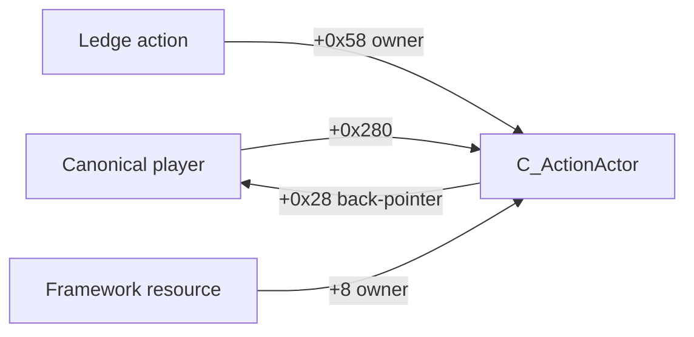

# Retail ledge admission observation

## v0.0.19 identity correction — revision4

The v18 manual baseline localized the failure to `action_owner_mismatch` after the exact primary action-vtable check passed. Original retail constructors now establish the actual type relationship: the canonical Cry player owns a separate WH `C_ActionActor`. The action's owner at+0x58 and the framework resource's owner at+8 are that component, not the canonical player. The old direct equality compared different objects and was incorrect. A zero-offset inheritance check within C_Player did not address this separate owned component.

Source chain: canonical actor constructor at`0x3f0bb8` calls factory`0x10e8078`, component constructor`0x10e80f8` writes vtable`0x3b098e0` and the original player at component+0x28, and move setter`0x515d90` transfers the actual component pointer into canonical player+0x280. RTTI names the component `wh::entitymodule::C_ActionActor`. The native attempt itself loads player+0x280 before obtaining the action framework, corroborating the call path. The subsequent v19 retail baseline validates this complete chain on two matched native requests.

Revision4 keeps full canonical player/controller/entity checks, then requires the exact component class, a component-to-player back-pointer, the action-to-component link and the framework-to-component link before copying the request. No pointer fallback, secondary-base adjustment or owner relaxation is used. New component null/read/class/back-pointer failures are precise and counted. Only target-relative component class/RVA is logged; raw pointers remain callback-scoped. A fully matched request now has2047 passed-check bits. Original forwarding, four hook sites, pre-call copy, exception cleanup and stop/restoration are unchanged. Parser contracts for revision2/3 remain historical and separate.

Owned fixtures model the player and component as genuinely different objects. They reject direct player-as-action-owner, a foreign component even with matching entity IDs, wrong component class/back-pointer/root link and protected-page faults. The ordinary small-obstacle check is complete:1,237 retained transactions,2 matched/accepted requests with2047 passed bits, no admission review problems and all six observer sites independently restored. The user confirmed visible climbing separately. Request flags remain uninterpreted; request acceptance does not establish completed animation or clearance. No further native-baseline repetition is needed. Added climbs remain disabled. [Full results](LedgeRuntimeResults.md).

## Historical revision3 investigation

## v0.0.18 trace correction — revision3

The v17 runtime failure could not identify which request predicate failed. Revision3 records the first failed check, passed-check bits, target-relative action-vtable identity and per-guard shutdown counts. Null/unreadable holders, unexpected primary/secondary interface, action-owner mismatch, invalid entity ownership, framework/core/resource failure and request-copy fault are distinct. A guarded refusal and a successfully copied request that differs from selection also have separate stages. Only actual guarded memory-copy faults count as unreadable. Every refusal remains explicit in the analyzer and never grants movement permission.

Original constructors, wrapper and RTTI were checked again. The primary action vtable, owner+0x58 and request+0x68 stores are corroborated. C_Player's C_Human/C_Actor/IActor bases have zero displacement; action secondary interfaces at+0x10/+0x50 are diagnosed and refused. No source-supported owner adjustment or relaxed guard was found. Consequently the actual cause of v17's three live failures remains unknown until revision3 observes one ordinary climb. This is a correction to tracing precision, not a claim that candidate-associated retail admission now passes.

Owned fixtures cover every first-failed predicate, protected-page read failures, known secondary interfaces, repeated guard calls without stale identity and exact shutdown counters, alongside original forwarding/exception/queue/restoration tests. The parser also preserves revision2 historical capture support. The four hook sites and all gameplay ownership checks are unchanged. No process, installation or new traversal was performed for this correction.

Static ledger `.local/native/ledge-v18/finding-ledger.json` retains full original-byte/RTTI pins and REA evidence `ev_45cd5d78f6ac02a3ed9505a725f37bb1e7a6a93e02abe729bee94dbcacecdece`. The217-byte derived constructor input omits the allocator cold path, callees, data, RTTI and unwind metadata; its retained Ghidra warning is corroborated by original instructions. The earlier216-byte truncated input is superseded. No unsupported inference from that partial input changes the runtime guard contract.

## v0.0.17 baseline and original contract

2026-10-21, v0.0.17 installed and same-spot observation complete. Target: KCD2 retail1.5.6/build23914554, `WHGame.dll` SHA-256 `bdf8f9e4a11257a72b64c84700e284c29e4c4ccaf5b8d4bfa7d0b2a7294479f7`. All addresses below are RVAs for this exact binary. These internal contracts began as static inferences, not a public API. Runtime search/selection/forwarding were observed, but the guarded action/request contract failed and remains unproved. [Initial selector/registry evidence](KCD2LedgeInterface.md), [runtime results](LedgeRuntimeResults.md).

## Observed path and ABI

| Boundary | RVA / established caller / return site | Forwarded contract |
|---|---|---|
| Existing standing attempt | `0x831b20` / `0x830263` / `0x830268` | Five arguments: opaque RCX, actor RDX, opaque R8, full R9, fifth stack pointer. Only the low R9W restriction is consumed on the inspected route. Preserve opaque slots and the raw AL return byte. |
| Candidate selection | `0x831eac` / `0x831cc8` / `0x831ccd` | Actor,8-byte output pair, alternate flag. Void output contract; type and encoded handle copied after return. |
| Nearby manager query | `0x832188` / `0x8320f5` / `0x8320fa` | Manager, output handle pointer, position pointer, direction pointer, **four** float stack arguments. Preserve returned pointer and output separately; a mismatch remains unknown. Bound meanings are not assigned speculative names. |
| Framework request result | `0x85612c` / `0x175e08b` / `0x175e090` | Framework and smart-pointer holder. Preserve raw AL; only0/1 is classified as a boolean. |

The outer attempt returns1 after trying the higher-level request wrapper; that wrapper at `0x175e008` discards the underlying framework result. Thus outer true alone cannot establish framework acceptance. The lower boundary at `0x85612c` preserves the result of framework virtual dispatch at `+0x20`. Framework true still establishes only this request boundary, not animation start, completion, collision safety or registration of a new ledge.

Decompiler limitations were resolved against original instructions and callers. The reduced attempt container was inferred as void around a security helper, but original AL assignments and the caller's AL test establish the byte return. The partial manager-query decompilation omits a cold branch and one parameter; original stack reads and the caller's four stack stores establish all four float arguments. Derived PEs omit external code/data/unwind information, so they are not independent ABI proof. Original16-byte entry and5-byte direct-call pins were reread and matched; the framework pin ends with the prefix of the next instruction and is a byte identity check, not a claimed whole-instruction boundary. MinHook decodes its own instruction span.

## Scope, ownership and lifetime

`Admission.cpp` forwards each original once and never calls a native function to initiate a traversal. Exact established return sites are required. Existing `ktwin::owner` validates controller/player/entity vtables, back-pointers and matching nonzero entity identity. The manager must match the pointer at `0x5484b38`. Unproved callers, changed ownership, unreadable memory and mismatches are excluded or explicitly unknown.

A fixed thread-local stack of four callback scopes links the standing attempt to nested query/selection/request calls. An otherwise valid standalone selector sample remains `selection_only`. Untracked nested calls suppress attribution to their parent. Multiple calls in one scope are ambiguous. Exceptions preserve host unwinding and clear counters/context. Actor addresses exist only during callbacks and are erased before return; queued/logged samples contain scalar values only.

The implementation guards the ledge-action vtable at `0x3c0d880`, action owner at `+0x58`, full owner chain and the framework's actor chain (`framework+8 -> core+0x50 -> resource+8`), then copies the12-byte request at action`+0x68`:8-byte selection plus four uninterpreted flag bytes. **This combined guard/copy failed in all three attributed v17 framework calls; no offset/vtable/owner assumption is runtime validated by those failures.** The failing sub-check is not recorded. The host may destroy the action while processing the smart pointer, so it is never read after the call. Numeric action type2 remains unmapped.

## Capture and interpretation

Production header: `probe=ledge-admission`, revision2, observe-only, four hooks, `motion_compiled=false`. A4096-slot queue,60000-record cap, bounded reservation and separate writer keep callback work finite and free of file I/O/Lua. Overflow/contention/truncation/write failure disable recording and remain explicit counters. Start pins the target, all four entries and callsites; stop disables all four hooks and drains callbacks before closing the writer. Module/trampolines remain pinned. A failed/uncertain stop is retryable; independent loader status checks every original entry.

Each completed scope records owner/thread, QPC lifetime and stage order, query vectors/four bounds/output, selection/alternate input, copied request, raw return bytes and typed unknowns. No pointer values or movement permission are logged. Principal outcomes:

| Outcome | Meaning |
|---|---|
| `before_query`, `no_query_handle` | Established attempt did not reach the query, or query returned its failure sentinel. Neither identifies a geometric root cause. |
| `selection_refused`, `query_selection_mismatch` | Selection refused the returned handle, or stages are not comparable. |
| `selected_only`, `no_framework_request` | Candidate observation without a proved framework request. |
| `framework_refused`, `framework_accepted` | One matched query/selection/request, normal outer return1, and known framework AL0/1. Acceptance is not completed climbing. |
| Unknown, context, ambiguity or exception stages | Evidence cannot support the comparable admission claim. Raw observations are retained. |

`tools/analyze_ledge_admission.py` validates schema, scalar types, scope/clock/order, copied pairs, known results and complete audit accounting. Its `allows_live_movement` is always false. It does not grant permission from a candidate or infer successful animation.

## Evidence and validation

Private original-byte pin report: `.local/evidence/20261021-v017-admission-pin-review.json`. Focused analysis under `.local/native/ledge-v17/` retains original raw reports and derived manifests. REA evidence IDs: standing selector `ev_51ee486cc5d4188225db9af5e13ef0e38eb6f1176500a85d5fd8c135d6eccebc`, partial manager query `ev_e628aec81b447d384395e37ee9318b1f9ecae5bedfb34c38fcfc6b60935f13a6`, framework boundary `ev_89bf8df9a8dec7f572192d7f6a3c0a9e99cd49c8833fc583ec1e6ce10344248a`. These retain the reduced-input limitations above; proprietary bytes stay ignored.

`tools/build_ledge_probe.ps1` builds separately in `.local/native/ledge-probe/build-v017` with warnings as errors. Owned-process tests detour all four functions, preserve register/stack arguments, output pointers and raw returns, destroy fixture action data during the host call, and exercise owner/caller refusals, unknowns, selected-only, nested isolation, exceptions,400 parallel transactions, bounded queue/capture failure, writer failure and restoration. Actual detoured samples pass through the production formatter into the Python analyzer. Five admission-review tests join the existing17 Python tests. These are offline checks, not a game attachment or retail climb result.

The same-spot observation retained8,232 transactions and all three raw framework AL1 returns, with null requests and zero qualified candidate-associated acceptances. `unreadable=3`/`framework_request_unassociated` remains an explicit review problem; it can represent guard/identity/layout refusal as well as unreadable memory. Do not suppress it or reinterpret true as a matched accepted climb. Owner refusals, audit drops/truncation and writer failures were zero. Both observers stopped and all six original sites independently restored. Installed v0.0.17 and source/tuning stayed unchanged during testing. Next recover the actual request/owner contract with precise guard refusal diagnostics. Added target insertion/removal, registered lifetime, swept body clearance and exclusive traversal handoff/interruption remain unresolved; added climbs stay disabled. [Plan](LedgeClimbing.md).
